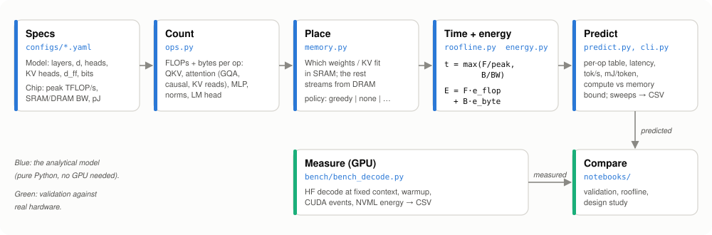
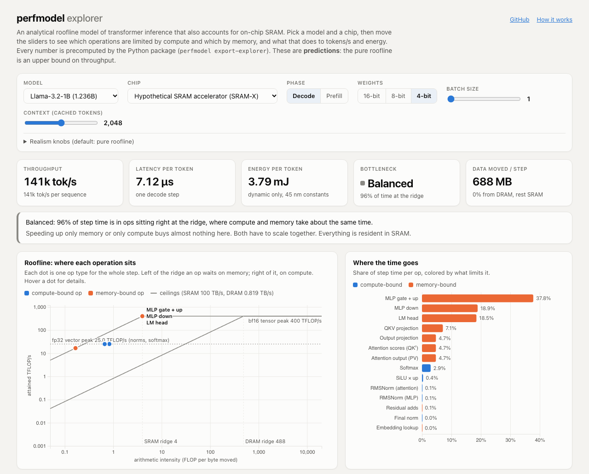
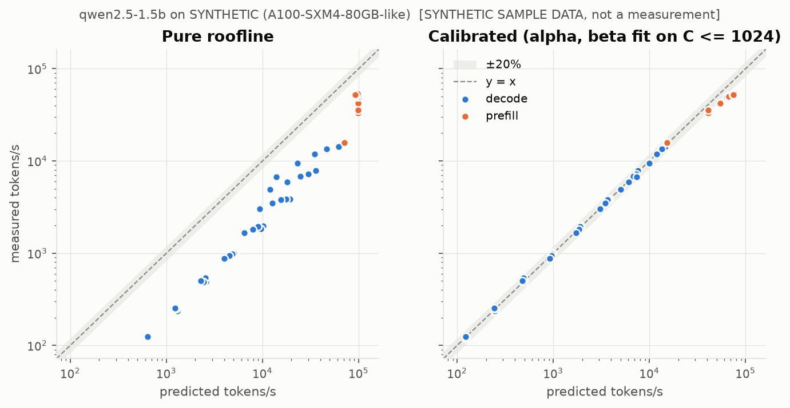
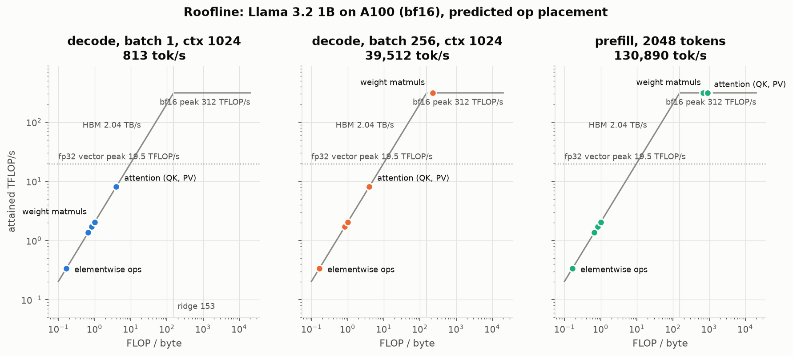
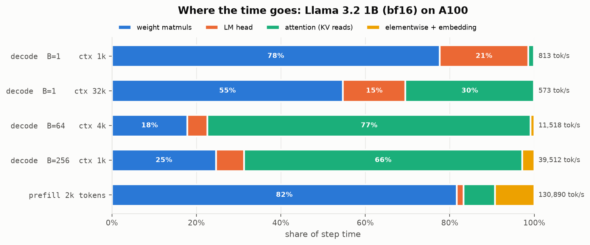
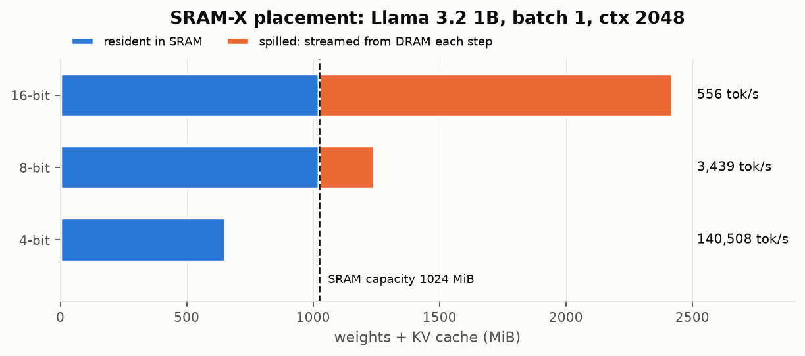

# perfmodel: an analytical performance and energy model for LLM inference

Given a transformer description and a chip description, `perfmodel` predicts
**prefill and decode latency, tokens/s, energy per token, and whether each
operation is compute- or memory-bound**. It uses a two-level roofline that
also models **on-chip SRAM capacity**: weights and KV cache that fit in SRAM
are served at SRAM bandwidth and energy, and the rest streams from DRAM.

The core is ~1,200 lines of dependency-light Python (dataclasses + YAML).
Every FLOP and byte formula is written out in [`ops.py`](src/perfmodel/ops.py),
and the unit tests check them against hand-computed values.

> **Validation status.** The model, CLI, tests, benchmark script and
> notebooks are complete. **No real GPU measurements are in this repo yet.**
> The validation plot below is built from a *synthetic* sample file
> (`bench/results/sample_synthetic.csv`, every row flagged `synthetic=1`) so
> the pipeline can be exercised end to end. Its error statistics validate
> nothing. To replace it with real data, run `bench/bench_decode.py` on a GPU
> (see [Validating on a GPU](#validating-on-a-gpu)).

**[Interactive explorer →](https://sanamang.github.io/Analytical-Performance-Model-for-LLM-Inference/)**
Pick a model, chip, precision, batch and context, and see which operations
are compute- or memory-bound, where the time goes, and what fits in SRAM.

---

## Problem

Choosing hardware for LLM inference, or designing it, comes down to a few
questions. Is decode limited by FLOPs or by bytes? How much on-chip memory
does it take to stop going to DRAM? What do quantization, batching and
speculative decoding buy on a given chip? Cycle-accurate simulators answer
these slowly, and measurements only exist for hardware you have. An
analytical model answers them in microseconds, for hardware that doesn't
exist yet, as long as you are honest about where it is wrong.

## How the model works



**1. Operation counts ([`ops.py`](src/perfmodel/ops.py)).** One forward step
processes `T` new tokens per sequence for `B` sequences with `P` tokens
already cached. Decode is `T = 1`, prefill is `P = 0`, and speculative
verification is `T = k + 1`. For each op (embedding, RMSNorms, QKV + RoPE,
attention scores, softmax, attention output, O-proj, residuals, gated MLP,
final norm, LM head) the model counts FLOPs, weight bytes, KV-cache bytes and
activation bytes. Key conventions:

- matmul `(M×K)·(K×N)` = `2MKN` FLOPs. Weights are read once per step and
  shared across the batch.
- causal attention does `S = T·P + T(T+1)/2` query-key pairs per head, and
  the KV cache is read once per sequence per KV head. GQA cuts KV bytes, not
  FLOPs.
- attention is fused (FlashAttention-style) by default: scores never leave
  the chip. `--unfused-attention` models the naive kernel.
- prefill computes logits only for the last position.

Sanity checks in the tests: decode FLOPs/token = 2 × matmul params within
1%, and parameter counts match the published 8.03B / 1.24B / 1.54B exactly.

**2. Placement ([`memory.py`](src/perfmodel/memory.py)).** Each tensor group
(QKV weights, MLP weights, embedding, KV cache, ...) gets a resident fraction
in SRAM. The policy is explicit and pluggable:
`none | greedy | weights_first | kv_first`. `greedy` fills SRAM by traffic
density (bytes read per step ÷ bytes of footprint), which is the
fractional-knapsack optimum for DRAM traffic. GPUs default to `none`: their
L2 is a hardware cache that streaming weights evict, not a scratchpad.

**3. Roofline ([`roofline.py`](src/perfmodel/roofline.py)).** For each op,
`t = max(FLOPs / peak, max(SRAM bytes / SRAM BW, DRAM bytes / DRAM BW))`.
Matmuls use the tensor-core peak at the model's compute dtype. Elementwise
ops use the vector (FP32) peak. An op is *compute-bound* if the compute term
wins. Arithmetic intensity is reported per op.

**4. Energy ([`energy.py`](src/perfmodel/energy.py)).**
`E = FLOPs·e_flop + SRAM bytes·e_sram + DRAM bytes·e_dram (+ P_static·t)`.
Defaults come from Horowitz, *Computing's Energy Problem*, ISSCC 2014 (45 nm),
and O'Connor et al., MICRO 2017 (HBM2 ≈ 3.9 pJ/bit). Both are **approximate**
and flagged as such. A modern node is several times more efficient per
operation, so trust energy *ratios* more than absolute joules.

**Configs.** [`configs/models`](configs/models): Llama 3 8B, Llama 3.2 1B,
Qwen2.5 1.5B (from their HF `config.json`).
[`configs/chips`](configs/chips): A100 SXM 80GB, H100 SXM 80GB, Jetson AGX
Orin 64GB, and **SRAM-X**, a clearly labeled *hypothetical* accelerator
(1 GiB SRAM at 100 TB/s, 400 TFLOP/s bf16, 0.82 TB/s HBM). Every number cites
its source. Derived or unverified values (e.g. Orin's dense FP16 peak, its
LPDDR5 energy) are marked in an `estimated:` list.

## Install and usage

```bash
uv sync                      # core + dev tools (pytest, ruff, matplotlib, jupyter)
uv run pytest                # 65 tests
uv run perfmodel list
```

```bash
uv run perfmodel predict --model llama3.2-1b --chip a100 --batch 1 --context 1024 --phase decode
```
```
Llama-3.2-1B (1.24B params, W16/KV16/A16, bf16) on NVIDIA A100 SXM4 80GB
DECODE  batch=1  context=1024
 op             kind     count   GFLOP   SRAM_MB   DRAM_MB   intensity   time_us   time_%   share of step   bound     energy_mJ
 ──────────────────────────────────────────────────────────────────────────────────────────────────────────────────────────────
 ...
 qkv_proj       matmul      16   0.201      0.00    201.49         1.0     98.82      8.0   █               memory        6.438
 attn_scores    matmul      16   0.067      0.00     16.86         4.0      8.27      0.7   ▏               memory        0.576
 ...
 mlp_up         matmul      16   1.074      0.00   1074.33         1.0    526.89     42.8   █████▏          memory       34.324
 ...
 lm_head        matmul       1   0.525      0.00    525.60         1.0    257.77     21.0   ██▌             memory       16.793
per-token latency: 1.230 ms   throughput: 812.8 tok/s   energy: 80.221 mJ/token
total: 2.61 GFLOP, 2.508 GB moved (2.508 GB DRAM), intensity 1.0 FLOP/B, 0% of time compute-bound -> step is memory-bound, SRAM used 0.0 MiB
```

In a terminal the table is colored by bound (blue = compute, orange =
memory) and includes a bar for each op's share of step time. Piped output
stays plain.

Useful flags: `--weight-bits 4`, `--kv-bits 8`, `--placement kv_first`,
`--unfused-attention`, `--overhead-us 10` (per-kernel launch cost). Chips and
models also accept a path to any YAML file.

```bash
uv run perfmodel sweep --model llama3.2-1b --chip sram-accel \
    --batches 1,8,64 --contexts 512,4096 --weight-bits 16,8,4 --out sweep.csv
```

From Python:

```python
from perfmodel import load_model, load_chip, predict_step
r = predict_step(load_model("llama3-8b").with_(weight_bits=4), load_chip("h100"),
                 batch=8, n_past=2048, n_new=1)
r.tokens_per_s, r.energy_per_token_j, r.to_frame()
```

## Interactive explorer

[](https://sanamang.github.io/Analytical-Performance-Model-for-LLM-Inference/)

[`docs/index.html`](docs/index.html) is a static page (D3, no build step)
served by GitHub Pages. It shows headline numbers, a plain-language verdict
on the bottleneck, a live roofline with every op, a time breakdown,
throughput-vs-batch and throughput-vs-context sweeps, the SRAM placement, and
a per-op table. The page does no modelling itself: `perfmodel
export-explorer` writes the predictions to `docs/data/*.json`. The optional
realism knobs (bandwidth/compute efficiency, per-kernel overhead) apply the
same formula as `predict_step`, and `tests/test_export.py` checks they agree.

```bash
uv run perfmodel export-explorer          # regenerate docs/data after changing configs
cd docs && python -m http.server 8000     # preview at http://localhost:8000
```

## Validation



**This plot uses synthetic data.** It shows what the validation notebook
produces, not a result. The notebook
([`a_validation.ipynb`](notebooks/a_validation.ipynb)):

- predicts every measured point with the **pure roofline** (100% efficiency,
  zero overhead) and reports MAPE / median / max error per phase;
- fits a two-parameter correction `t ≈ α·t_roofline + β·n_kernels`
  (achieved fraction of roofline, per-kernel overhead) on contexts ≤ 1024 and
  scores it on **held-out** longer contexts;
- fits `E ≈ k·E_dynamic + P_static·t` for energy and compares `P_static` with
  measured idle power;
- lists where the model is expected to be wrong. Briefly: HF eager's per-kernel
  Python/launch overhead dominates small-batch decode; peak bandwidth is not
  reachable; `DynamicCache` copies the KV cache every step; prefill GEMMs reach
  only part of tensor-core peak; L2 hits make some ops beat the DRAM roofline;
  and 45 nm energy constants plus missing static power make absolute energy wrong.

## Key findings (model predictions)

From [`c_design_study.ipynb`](notebooks/c_design_study.ipynb) and
[`b_roofline.ipynb`](notebooks/b_roofline.ipynb). These are pure-roofline
predictions: upper bounds on throughput, lower bounds on energy.





1. **Batch-1 decode is entirely bandwidth-bound.** Every weight matmul sits at
   1 FLOP/byte (bf16), 150x left of the A100 ridge. Llama 3.2 1B: 2.5 GB per
   token → ≈ 1.2 ms → ≈ 810 tok/s on A100.
2. **Weight matmuls flip to compute-bound at B ≈ ridge** (≈ 153 on A100,
   ≈ 295 on H100 at bf16), as `intensity = 2B / bytes_per_weight` predicts.
   **The whole decode step never flips** at context ≥ 512, even at
   B = 32768. KV-cache reads grow with B × context and are never shared
   across the batch, so attention takes over as the bottleneck. Large-batch
   serving is limited by KV bandwidth and capacity, not by FLOPs.
3. **It takes ≈ 589 MiB of SRAM to hold Llama 3.2 1B at 4-bit** (≈ 626 MiB
   with group-wise scales). The tied 128k-vocab embedding is 125 MiB of
   that, and each 2k-token sequence adds 64 MiB of KV.
4. **SRAM capacity is a cliff, not a slope.** On SRAM-X, the 4-bit 1B model
   fits and decodes at ≈ 150k tok/s at batch 1 (with resident 4-bit weights,
   the matmuls sit exactly on the SRAM ridge at ≈ 4 FLOP/B, so compute and
   memory time are balanced and speeding up only one of them barely helps). The 16-bit model spills more than half its bytes
   to DRAM and is *slower than an A100* (569 vs 813 tok/s). Batching can hurt
   too: at batch 64 the KV cache overflows SRAM and throughput drops ~5x.
   Llama 3 8B never fits, so SRAM-X is a worse 8B decoder than an A100 at
   every precision.

   
5. **Weight quantization on a GPU at batch 1:** 16 → 8 → 4 bit gives ≈ 2.0x /
   3.8x tokens/s and ≈ 0.52x / 0.28x energy per token, since DRAM bytes
   dominate decode energy. The benefit shrinks with batch as KV traffic and
   compute take over.
6. **Speculative decoding** (8B target, 1B draft, A100, batch 1): verifying
   k + 1 tokens costs about the same as decoding one, so the predicted speedup
   is ≈ 1.6x (acceptance 0.7) to ≈ 2.5x (0.9). With free drafts the ideal is
   up to ≈ 6x. At batch 128 the verify step is compute-bound and the speedup
   falls to ≈ 1 or below. It is a small-batch, memory-bound optimization.

## Limitations

- **Upper bound by design.** No kernel-launch or framework overhead, no
  partial efficiency, unless you opt in with `overhead_per_op_s`,
  `bandwidth_efficiency` or `compute_efficiency`.
- **No overlap across ops.** Step time is the sum of per-op times. Real
  stacks overlap some kernels (and fuse norms, activations and residuals that
  the model counts separately).
- **Caches are not modeled on GPUs.** L2 is treated as absent, and SRAM
  placement is fractional and static within a step.
- **Single device.** No tensor or pipeline parallelism, interconnect, or
  host↔device traffic. No paged-attention or sampling overhead.
- **Quantization is weight-only.** Matmuls compute at `compute_dtype`.
  Group-scale overhead is modeled only if you pass fractional bits (4.25).
  Dequantization cost is ignored, and the LM head and embedding are
  quantized like other weights.
- **Energy constants are 45 nm (Horowitz 2014) and approximate.** Static
  power defaults to 0. Orin's LPDDR5 energy uses a DDR3 figure as an upper
  bound.
- **SRAM-X is hypothetical.** Its numbers are design assumptions, not a product.

## Validating on a GPU

```bash
uv sync --extra bench
uv run python bench/bench_decode.py --model-id Qwen/Qwen2.5-1.5B \
    --out bench/results/a100_qwen2.5-1.5b.csv
PERFMODEL_BENCH_CSV=bench/results/a100_qwen2.5-1.5b.csv \
    uv run python notebooks/build_notebooks.py --run
```

The script measures decode at a *fixed* context (it crops the KV cache back
after each step), uses warmup steps and `torch.cuda.Event` timing, sizes each
run to ≥ 2 s so NVML power averaging is meaningful, reads NVML's energy
counter (or integrates power samples), records idle power, and appends each
row as it goes so an OOM doesn't lose earlier results. If your GPU isn't the
SXM 80GB A100/H100 (e.g. A100 40GB at 1555 GB/s, or a PCIe card), copy the
chip YAML, fix the bandwidth and pass `--perfmodel-chip`.

## Layout

```
src/perfmodel/  specs.py ops.py roofline.py memory.py energy.py predict.py cli.py export.py
configs/        chips/*.yaml  models/*.yaml   (sources and estimates noted inline)
bench/          bench_decode.py (GPU), make_sample_data.py (synthetic), results/
notebooks/      a_validation, b_roofline, c_design_study (+ build_notebooks.py)
tests/          specs, ops, roofline, memory/energy, predict/CLI
docs/           index.html (explorer), data/ (generated JSON), figures/ (plots)
```

## References

- S. Williams, A. Waterman, D. Patterson. *Roofline: An Insightful Visual Performance Model.* CACM 2009.
- C. Yang, T. Kurth, S. Williams. *Hierarchical Roofline Analysis for GPUs.* CCPE 2020.
- M. Horowitz. *Computing's Energy Problem (and what we can do about it).* ISSCC 2014.
- M. O'Connor et al. *Fine-Grained DRAM: Energy-Efficient DRAM for Extreme Bandwidth Systems.* MICRO 2017.
- Y. Leviathan, M. Kalman, Y. Matias. *Fast Inference from Transformers via Speculative Decoding.* ICML 2023.
- T. Dao et al. *FlashAttention.* NeurIPS 2022.
- NVIDIA A100 / H100 datasheets and architecture whitepapers. Jetson AGX Orin datasheet.
